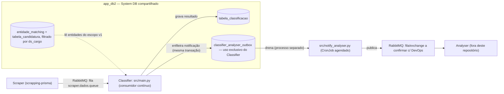

# Classifier — Prisma

Componente responsável por classificar, individualmente, o teor de cada conteúdo coletado sobre políticos e partidos. Fica no meio do pipeline da plataforma Prisma:

```
Scraper (scrapping-prisma) --RabbitMQ--> Classifier (este repositório) --RabbitMQ--> Analyser
```

## Visão geral

O Classifier recebe um conteúdo já coletado (ex.: notícia), identifica quais políticos/partidos são mencionados, classifica o teor de cada trecho em relação a cada entidade (`neutro` / `negativo` / `positivo`), persiste o resultado no System DB e sinaliza o Analyser de que há resultado novo para agregar.



`app_db2` é o System DB **compartilhado** da plataforma — `entidade_matching` e `tabela_classificacao` também são lidas/gravadas por outros componentes. `classifier_analyser_outbox` mora fisicamente no mesmo banco, mas é de uso **exclusivo** do Classifier (só ele lê e escreve) — ver ADR 0004 e a seção "Persistência e integração" abaixo.

Este README cobre **como rodar o projeto**. Para responsabilidade detalhada, contrato de dados, regras de classificação, riscos e decisões em aberto, ver [`context.md`](context.md) (contexto deste repositório) e o `context.md` da raiz do Lab-inovação (fonte da verdade do produto).

Não é responsabilidade deste componente: coletar conteúdo, gerar análise agregada por entidade, expor API pública, apresentar resultado em interface, ou classificar viés político/ideológico (decisão de escopo do produto).

## Arquitetura resumida

### Modo de execução

Dois processos de produção (ver ADR 0004):

- `src/main.py` — daemon (contínuo) que consome a fila do Scraper, classifica, persiste em `tabela_classificacao` e enfileira a notificação pendente pro Analyser em `classifier_analyser_outbox`, na mesma transação, antes do commit. Não publica nada no RabbitMQ diretamente. Precisa ficar no ar (ex.: serviço/supervisor).
- `src/notify_analyser.py` — processo separado ("roda uma vez e sai", agendável via cron) que drena `classifier_analyser_outbox` e publica de fato no RabbitMQ, com retry e circuit breaker.

### Fluxo de classificação (pipeline)

Para cada mensagem consumida (um conteúdo):

1. **Segmentação** (`src/segmentation.py`) — separa o texto em parágrafos. Hoje só existe estratégia para `content_type = news_article`.
2. **Identificação de entidades** (`src/entity_matcher.py`) — para cada parágrafo, verifica quais políticos/partidos (carregados de `entidade_matching`, ver "Escopo de entidades (v1)" abaixo) são mencionados, por match exato (por palavra) ou fuzzy (rapidfuzz, contra janelas de palavras do mesmo tamanho do apelido). Não é NER.
3. **Classificação léxico/regra** (`src/lexicon.py`) — para cada parágrafo com pelo menos uma entidade identificada, conta ocorrências de termos positivos/negativos de `config/lexicon.yaml` e decide a categoria pela contagem maior. Essa é a baseline v1 — ver limitações abaixo.

O resultado é uma linha por (parágrafo, entidade) — `src/pipeline.py` é uma função pura, testável sem banco/fila.

### Escopo de entidades (v1)

Decisão de produto (equipe, 2026-08-28) — **não é limitação técnica**: por enquanto o Classifier só processa candidatos a **presidente e vice-presidente**, e os partidos vinculados a eles. Não é o universo inteiro de `entidade_matching` (~1.400 registros).

- Fonte: `entidade_matching` (System DB compartilhado `app_db2`, dado real do TSE), filtrada por `ds_cargo` — lista configurável em `config/settings.yaml` (`entity_scope.cargos`, hoje `["PRESIDENTE", "VICE-PRESIDENTE"]`). Implementação em `src/entities_store.py::load_active_entities_from_db`.
- Recorte atual: **40 entidades** (26 políticos + 14 partidos), confirmado contra o banco real.
- Ampliar o escopo (hipótese não confirmada para uma v2: governador+vice+senador) é só atualizar essa lista em `config/settings.yaml` — não exige mudança de código.
- Risco de produto em aberto, não resolvido por esta decisão: se o `scrapping-prisma` continuar raspando notícia geral sem filtrar por presidenciável, boa parte do conteúdo raspado não vai gerar classificação nenhuma. Ver [`data/annotation/pendencias-tecnicas.md`](data/annotation/pendencias-tecnicas.md), [`docs/propostas-mudancas-scraper.md`](docs/propostas-mudancas-scraper.md) (proposta de alinhamento) e [`docs/scraper-como-atualizar-target-entities.md`](docs/scraper-como-atualizar-target-entities.md) (como o scraper recebe a lista de entidades em escopo).
- Performance do `entity_matcher`: houve uma otimização (pré-filtro de candidatos + índice de aliases + cache de regex) que trouxe o matching de ~130ms para ~0,6ms por parágrafo em benchmark com 1.393 entidades sintéticas (~200x), depois validada com dado real do TSE (números exatos em `data/annotation/pendencias-tecnicas.md`, item 7). Com o escopo v1 atual (40 entidades) o custo é irrelevante (~0,09ms/parágrafo) — a otimização só volta a importar se o escopo crescer além da v1.

### Persistência e integração

- **Scraper → Classifier**: consumo via RabbitMQ, sem acesso direto ao Postgres do scraper, padrão outbox do lado do scraper. Ver [ADR 0001](docs/adr/0001-scraper-classifier-rabbitmq-outbox.md).
- **Classifier grava em `tabela_classificacao`**, no System DB compartilhado `app_db2` (não mais nas tabelas próprias do Classifier — ver "Tabelas principais" abaixo).
- **Classifier → Analyser**: outbox transacional próprio (`classifier_analyser_outbox`, tabela de uso interno do Classifier dentro do `app_db2` — não faz parte do modelo de dados compartilhado). `src/message_handler.py` grava o payload de notificação nessa tabela NA MESMA transação do `INSERT` em `tabela_classificacao`, antes do commit — nunca publica no RabbitMQ diretamente. Um processo separado, `src/notify_analyser.py` (agendável via cron), drena as linhas pendentes e publica de fato no RabbitMQ, com retry (`attempts`/`max_attempts`) e circuit breaker de falhas consecutivas. Essa é a decisão vigente (ADR 0004) — supera a publicação direta e síncrona da ADR 0003 (que perdia notificação silenciosamente se o RabbitMQ estivesse fora do ar no momento da publicação) sem repetir o impasse da ADR 0002 (lá, o outbox seria uma tabela do schema *compartilhado*, sem dono definido; aqui é uma tabela de uso exclusivo do Classifier). Formato do payload já é contrato fechado do lado do Classifier (decisão da Bea, 2026-08-29 — ver "Decisões em aberto" abaixo); nome de fila/exchange **ainda não confirmado com o DevOps**. Ver [ADR 0002](docs/adr/0002-system-db-compartilhado-outbox-analyser.md) e [ADR 0003](docs/adr/0003-notificacao-analyser-publicacao-direta.md) (contexto histórico) e [ADR 0004](docs/adr/0004-outbox-proprio-para-notificacao-analyser.md) (decisão vigente).
- `src/notify_analyser.py`, `src/notification_publisher.py` e `src/notifications_store.py` foram reativados e adaptados para `classifier_analyser_outbox` — fazem parte do fluxo de produção de novo. Agendamento (CronJob em Kubernetes) fica por conta do time de infra — não é mais pendência deste repositório (ver "Decisões em aberto" abaixo).

Em produção o Classifier não declara/cria topologia nenhuma no RabbitMQ (nem para consumo, nem para notificação) — isso é responsabilidade do DevOps. O RabbitMQ do `docker-compose.yml` é só para desenvolvimento local e já sobe com a topologia provisionada (ver [`docker/rabbitmq/README.md`](docker/rabbitmq/README.md)).

### Configuração versionada (`config/`)

- `config/entities.yaml` — YAML legado, curado manualmente. **Não é mais a fonte usada em produção** desde a migração para `entidade_matching` (ver "Escopo de entidades (v1)" acima) — hoje só alimenta scripts de benchmark/anotação (`scripts/benchmark_entity_matcher.py`, `scripts/build_annotation_batches.py`). Ver comentário de topo em `src/main.py`.
- `config/lexicon.yaml` — lista artesanal de termos positivos/negativos em PT-BR. Não é um léxico validado academicamente (não é SentiLex-PT nem OpLexicon) — é ponto de partida da baseline.
- `config/settings.yaml` — threshold do fuzzy matching, escopo de cargos filtrados em `entidade_matching` (`entity_scope.cargos`), nome/versão do modelo gravados em cada execução, caminho do arquivo de log.

### Tabelas principais

Em **produção**, o Classifier grava em `tabela_classificacao` (System DB compartilhado `app_db2`, schema gerenciado por outra pessoa da equipe via DBeaver — não faz parte de `db/migrations/` deste repositório). Uma linha por (parágrafo, entidade) identificada, com FK para `tabela_politico`/`tabela_partido`/`tabela_midia`, categoria, confiança, evidência (`paragrafo_analisado`) e auditoria de match (`evidencia_match`). Idempotência via `ON CONFLICT` na constraint `uq_tabela_classificacao_idempotencia` (article + parágrafo + entidade + pipeline_version) — ver `src/classification_store.py::persist_classification_result_v2`.

`db/migrations/` (aplicadas só em `classifier_test`, nunca em `app_db2`) cobrem duas coisas:

- `0001`-`0004` — schema ANTIGO e órfão do Classifier (`political_entities`, `classification_runs`, `classifications`, `analyser_notifications`) — não é mais gravado em produção, mantido por não haver necessidade comprovada de removê-lo agora.
- `0005` — réplica **só para teste** do schema novo confirmado em `app_db2` (`tabela_classificacao`, `tabela_midia`, `tabela_politico`, `tabela_partido`) — permite testar `persist_classification_result_v2`/`resolve_id_midia` isolado, sem depender de rede até o banco real. Mantida manualmente em sincronia com o schema real; não há automação ligando os dois hoje.
- `0006` — réplica **só para teste** de `classifier_analyser_outbox` (ver ADR 0004) — mesma lógica da `0005`: a tabela real é criada manualmente em `app_db2` (`scripts/sql/003_classifier_analyser_outbox.sql`), não por estas migrations.

## Como rodar localmente

Pré-requisitos:

- Python 3.14 (confirmado no `.venv` deste repositório)
- Docker (para subir Postgres e RabbitMQ localmente via `docker-compose.yml`)

Passos:

```bash
# 1. Copiar o .env de exemplo e ajustar valores conforme necessário
cp .env.example .env

# 2. Subir Postgres e RabbitMQ locais
docker compose up -d

# 3. Criar/ativar um virtualenv e instalar dependências
python3.14 -m venv .venv
source .venv/bin/activate
pip install -r requirements.txt

# 4. Rodar o consumidor (processo contínuo — fica no ar consumindo a fila do
# Scraper, classifica, persiste em tabela_classificacao e enfileira a
# notificação pendente em classifier_analyser_outbox, na mesma transação —
# ver ADR 0004)
python src/main.py
```

`src/notify_analyser.py` é o segundo processo de produção ("roda uma vez e sai") — drena `classifier_analyser_outbox` e publica de fato no RabbitMQ. Em produção o agendamento é um CronJob em Kubernetes, gerenciado pelo time de infra; localmente, rode manualmente sempre que quiser drenar o outbox — sem isso, as notificações ficam acumuladas como `pending`:

```bash
python src/notify_analyser.py
```

Em produção o consumidor (`src/main.py`) **não** roda migrations do System DB (`app_db2` é gerenciado por outra pessoa da equipe, ver comentário no próprio arquivo) — só em `classifier_test`, via `tests/conftest.py`.

**Se você já tem um Postgres local (ex.: instalado via Homebrew, ouvindo em `5432`)**: `docker compose up -d` sobe um SEGUNDO Postgres no mesmo host/porta, e qual dos dois efetivamente atende `localhost:5432` fica ambíguo (depende de como o Docker Desktop/OrbStack expõe a porta). Nesse caso, suba só o RabbitMQ (`docker compose up -d rabbitmq`) e use o Postgres que já está rodando — ele funciona normalmente, o classifier só precisa que `POSTGRES_HOST`/`POSTGRES_PORT` no `.env` apontem pra ele.

## Variáveis de ambiente

Todas descritas com comentário completo em [`.env.example`](.env.example). Resumo:

**Postgres (System DB)**
- `POSTGRES_HOST`, `POSTGRES_PORT`, `POSTGRES_DB`, `POSTGRES_USER`, `POSTGRES_PASSWORD` — conexão com o banco compartilhado (Classifier grava resultado; Analyser e API o lerão depois).
- `POSTGRES_TEST_DB` — banco lógico separado usado pelos testes, mesmo servidor.

**RabbitMQ — consumo da fila do Scraper** (nomes já confirmados com o DevOps)
- `RABBITMQ_HOST`, `RABBITMQ_PORT`, `RABBITMQ_VHOST` — conexão com o broker.
- `RABBITMQ_MANAGEMENT_PORT` — porta da UI de management do RabbitMQ local (`docker-compose.yml`, container `rabbitmq:3-management`), só para desenvolvimento — inspecionar filas em `http://localhost:15672`. Não existe em produção.
- `RABBITMQ_CONSUMER_USER`, `RABBITMQ_CONSUMER_PASSWORD` — credenciais de consumo (defaults `guest/guest` são só o padrão local; credenciais reais de produção ainda não confirmadas com o DevOps).
- `RABBITMQ_CONSUMER_QUEUE` — fila de onde o Classifier consome os jobs do Scraper.
- `RABBITMQ_CONSUMER_PREFETCH_COUNT` — quantas mensagens não confirmadas o consumidor aceita por vez.
- `RABBITMQ_RECONNECT_DELAY_SECONDS` — intervalo de espera antes de tentar reconectar se a conexão cair.

**RabbitMQ — notificação para o Analyser** (nomes ainda NÃO confirmados com o DevOps — placeholders de desenvolvimento)
- `RABBITMQ_NOTIFIER_USER`, `RABBITMQ_NOTIFIER_PASSWORD` — credenciais de publicação.
- `RABBITMQ_NOTIFIER_EXCHANGE`, `RABBITMQ_NOTIFIER_EXCHANGE_TYPE`, `RABBITMQ_NOTIFIER_QUEUE`, `RABBITMQ_NOTIFIER_ROUTING_KEY`, `RABBITMQ_NOTIFIER_DURABLE` — topologia usada por `src/notify_analyser.py`. Não usar esses valores como definitivos em produção sem confirmar com o DevOps antes.

## Como testar

```bash
pytest
```

Os testes usam um banco de teste isolado (`POSTGRES_TEST_DB`), criado e com as migrations aplicadas automaticamente pelo `tests/conftest.py` — não é preciso preparar banco manualmente, só ter Postgres no ar (`docker compose up -d`) e o `.env` configurado. As tabelas de dados são limpas (`TRUNCATE`) antes de cada teste, incluindo a réplica de teste do schema novo (`tabela_classificacao`, `tabela_midia`, `tabela_politico`, `tabela_partido` — ver `db/migrations/0005`) e a réplica de `classifier_analyser_outbox` (`db/migrations/0006`).

Publicação no RabbitMQ nunca é testada contra um broker real:
- `tests/test_message_handler.py` verifica que `handle_message` grava a linha certa em `classifier_analyser_outbox`, na mesma transação de `tabela_classificacao` (inclui um teste de atomicidade que força uma falha entre a gravação do outbox e o commit).
- `tests/test_notification_publisher.py` injeta um publisher fake (`Publisher` Protocol) para testar claim/retry/circuit-breaker/idempotência do publisher do outbox, sem depender de infraestrutura externa.

Exceção: `tests/test_entities_store.py` conecta diretamente ao `app_db2` real (só leitura) para validar o recorte de entidades v1 contra dado de verdade — não usa `classifier_test`, porque `entidade_matching`/`tabela_candidatura` são gerenciadas fora deste repositório e não têm réplica de teste. Precisa de rede até o `app_db2` para rodar.

## Limitações conhecidas da baseline v1 (léxico/regra)

- **Granularidade por parágrafo, não por entidade**: se duas entidades diferentes aparecem no mesmo parágrafo, ambas recebem a mesma categoria e confiança — não há atribuição fina de qual trecho se refere a qual entidade.
- **Confiança é heurística, não probabilidade calibrada**: `|positivos - negativos| / (positivos + negativos)`, sem qualquer validação estatística.
- **Só suporta `content_type = news_article`**. Outro tipo de conteúdo levanta erro explícito (`UnsupportedContentTypeError`) em vez de cair silenciosamente na estratégia de parágrafo.
- **Não considera negação, ironia, citação de terceiros ou comparação** — conta termos positivos/negativos no parágrafo inteiro, sem entender contexto.
- **Identificação de entidade não é NER**: depende da lista carregada de `entidade_matching`, já filtrada pelo escopo v1 (match exato + fuzzy). Entidade fora desse recorte (ex.: um deputado, ou um presidenciável fora dos `ds_cargo` configurados) não é identificada.

Essa baseline existe para validar o pipeline ponta a ponta e servir de referência de comparação para uma técnica melhor (fase 2 planejada: LSTM com embeddings pré-treinados em português).

## Decisões em aberto / próximos passos

Ver [`context.md`, seção 9](context.md#9-decisões-em-aberto-específicas-deste-repositório) — inclui a técnica de classificação definitiva pós-baseline, correferência de entidade, dono das migrations do System DB quando o Analyser existir, e confirmação com o DevOps do nome da fila/exchange da notificação Classifier→Analyser.

**Formato do payload de notificação está fechado** (decisão da Bea, 2026-08-29): o modelo de dados do Classifier (`tabela_classificacao` + payload de `src/analyser_notifier.py::build_notification_payload`, documentado em [`docs/dicionario-dados-analyser.md`](docs/dicionario-dados-analyser.md)) é a referência fixa — quem construir o Analyser adapta o próprio consumo a esse formato, não o contrário. Não é mais pendência deste lado.

**Agendamento de `src/notify_analyser.py` também está resolvido**: fica por conta do time de infra (CronJob em Kubernetes, configurado manualmente no Gitea) — não é mais pendência deste repositório.

Pendências que continuam reais (ver [ADR 0003](docs/adr/0003-notificacao-analyser-publicacao-direta.md) e [ADR 0004](docs/adr/0004-outbox-proprio-para-notificacao-analyser.md)):

- Nome de fila/exchange/routing key da fronteira Classifier→Analyser ainda não confirmados com o DevOps.
- `notificado_em` no payload reflete "quando a classificação foi enfileirada", não "quando foi de fato publicada no RabbitMQ" (pode haver atraso, ver ADR 0004) — já está documentado no dicionário de dados entregue, mas vale reforçar se o time do Analyser tiver dúvida.
- Mapeamento `ScraperPayload.source_name` → `tabela_midia.nome_midia` (`src/classification_store.py::resolve_id_midia`) usa lookup exato case-insensitive. Medido contra dado real (2026-08-29): só **33,5%** dos `source_name` reais já coletados (181/540) batem com o cadastro atual de `tabela_midia` (10 veículos) — a maioria fica com `id_midia` nulo (não bloqueia nada, mas é limitação conhecida até alguém investir em cadastrar mais veículos ou melhorar o lookup).

## Estrutura de pastas

```
config/          Entidades, léxico e configurações versionadas (YAML)
db/migrations/   Migrations SQL do System DB, numeradas
docker/rabbitmq/ Topologia do RabbitMQ para desenvolvimento local (docker-compose)
docs/adr/        Decisões de arquitetura registradas
src/             Código do consumidor, publisher, pipeline de classificação e acesso a dados
tests/           Testes automatizados (pytest), incluindo setup do banco de teste
logs/            Log de execução (não versionado)
```
