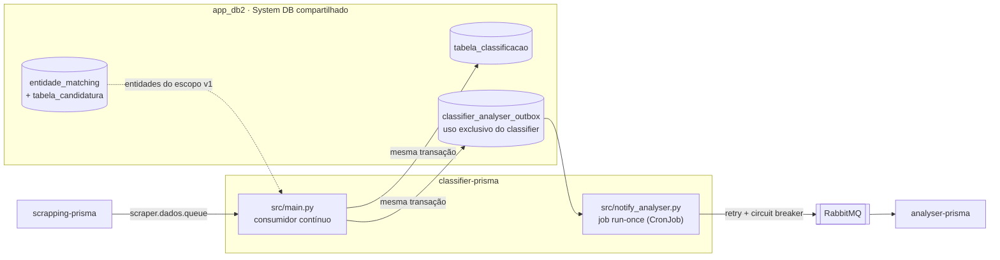

<div align="center">

# classifier-prisma

**Classificador do PRISMA**: consome as notícias coletadas, identifica os políticos e partidos citados em cada parágrafo e classifica o teor do trecho (`positivo` / `neutro` / `negativo`) em relação a cada entidade.


[Organização PRISMA](https://github.com/prisma-projetos) · [Documentação e experimentos](https://github.com/prisma-projetos/experiments-prisma)

</div>

---

## Onde este módulo fica no PRISMA

```
scrapping-prisma ──RabbitMQ──▶ [ classifier-prisma ] ──RabbitMQ──▶ analyser-prisma ──▶ System DB ──▶ api-prisma ──▶ app-prisma
                                  ▲ você está aqui
```

## Sumário

- [Visão geral](#visão-geral)
- [Arquitetura](#arquitetura)
- [Pipeline de classificação](#pipeline-de-classificação)
- [Persistência e integração](#persistência-e-integração)
- [Estrutura do repositório](#estrutura-do-repositório)
- [Como rodar](#como-rodar)
- [Variáveis de ambiente](#variáveis-de-ambiente)
- [Testes](#testes)
- [CI/CD](#cicd)
- [Limitações da baseline v1](#limitações-da-baseline-v1)
- [Documentação](#documentação)
- [Repositórios do PRISMA](#repositórios-do-prisma)

## Visão geral

| | |
|---|---|
| **Entrada** | Mensagens da fila `scraper.dados.queue` com o texto completo da notícia |
| **Processamento** | Segmentação em parágrafos → *matching* de entidades (exato e fuzzy) → classificação por léxico |
| **Unidade de saída** | Uma linha por **(parágrafo, entidade)**, com categoria, confiança e evidência |
| **Persistência** | `tabela_classificacao` no System DB compartilhado (`app_db2`) |
| **Notificação** | Outbox próprio (`classifier_analyser_outbox`) drenado para o RabbitMQ → `analyser-prisma` |
| **Escopo v1** | Candidatos a **presidente e vice-presidente** e seus partidos: 40 entidades (26 políticos e 14 partidos, dados do TSE) |

**Fora do escopo:** coletar conteúdo, agregar análise por entidade, expor API pública e classificar viés ideológico (por decisão de produto).

## Arquitetura



Dois processos em produção ([ADR 0004](docs/adr/0004-outbox-proprio-para-notificacao-analyser.md)):

| Processo | Tipo | Responsabilidade |
|---|---|---|
| `src/main.py` | *Daemon* (Deployment) | Consome a fila, classifica e grava o resultado e a notificação pendente **na mesma transação**. Só faz ACK depois do commit |
| `src/notify_analyser.py` | *Run-once* (CronJob) | Drena o outbox e publica no RabbitMQ com retry (`attempts`/`max_attempts`) e circuit breaker |

## Pipeline de classificação

`src/pipeline.py` é uma **função pura**, testável sem banco nem fila.

| # | Etapa | Módulo | Como |
|---|---|---|---|
| 1 | Segmentação | `segmentation.py` | Divide o texto em parágrafos. Só aceita `content_type = news_article` |
| 2 | Identificação de entidades | `entity_matcher.py` | Match exato por palavra e fuzzy (`rapidfuzz`) contra os aliases de `entidade_matching`. **Não é NER** |
| 3 | Classificação | `lexicon.py` | Conta termos positivos e negativos de `config/lexicon.yaml`; a contagem maior define a categoria |

- **Confiança:** `|pos − neg| / (pos + neg)`. É uma heurística, não uma probabilidade calibrada.
- **Performance do matcher:** um pré-filtro com índice de aliases e cache de regex levou o custo de cerca de 130 ms para cerca de 0,6 ms por parágrafo com 1.393 entidades (aproximadamente 200 vezes mais rápido). No escopo v1, de 40 entidades, fica em cerca de 0,09 ms.
- **Ampliar o escopo** (por exemplo, governador e senador) exige só editar `entity_scope.cargos` em `config/settings.yaml`, sem mudar código.

## Persistência e integração

| Fronteira | Mecanismo | Decisão |
|---|---|---|
| Scraper → Classifier | RabbitMQ (outbox no scraper). O classifier **nunca** acessa o banco do scraper | [ADR 0001](docs/adr/0001-scraper-classifier-rabbitmq-outbox.md) |
| Classifier → System DB | `INSERT` idempotente em `tabela_classificacao` (`ON CONFLICT` em artigo + parágrafo + entidade + `pipeline_version`) | [ADR 0002](docs/adr/0002-system-db-compartilhado-outbox-analyser.md) |
| Classifier → Analyser | Outbox transacional próprio + publisher separado | ~~[ADR 0003](docs/adr/0003-notificacao-analyser-publicacao-direta.md)~~ → [ADR 0004](docs/adr/0004-outbox-proprio-para-notificacao-analyser.md) (vigente) |

- O **formato do payload** enviado ao analyser já está fechado: veja [`docs/dicionario-dados-analyser.md`](docs/dicionario-dados-analyser.md) e `src/analyser_notifier.py::build_notification_payload`.
- O schema de `app_db2` é gerenciado fora deste repositório. Os DDLs aplicados manualmente estão em `scripts/sql/`.
- `db/migrations/` é aplicado **somente no banco de teste**:
  - `0001`–`0004`: schema antigo, que não recebe mais gravações em produção;
  - `0005` e `0006`: réplicas de teste de `tabela_classificacao`, das tabelas relacionadas e do outbox.
- Em produção o classifier **não declara topologia** no RabbitMQ. O `docker-compose.yml` sobe um broker já provisionado só para desenvolvimento ([`docker/rabbitmq/`](docker/rabbitmq/README.md)).

## Estrutura do repositório

```
├── config/
│   ├── settings.yaml        # threshold fuzzy, escopo de cargos, versão do modelo, log
│   ├── lexicon.yaml         # léxico PT-BR artesanal (baseline)
│   └── entities.yaml        # legado: só benchmarks e anotação
├── src/
│   ├── main.py              # consumidor contínuo (entrypoint 1)
│   ├── notify_analyser.py   # drena o outbox (entrypoint 2)
│   ├── pipeline.py          # segmentação → matching → léxico (função pura)
│   ├── segmentation.py · entity_matcher.py · lexicon.py
│   ├── message_handler.py   # transação: classificação + outbox + ACK
│   ├── classification_store.py · entities_store.py · notifications_store.py
│   ├── rabbitmq_consumer.py · rabbitmq_publisher.py · notification_publisher.py
│   └── payload.py · analyser_notifier.py · storage.py
├── db/migrations/           # schema de teste (nunca aplicado em app_db2)
├── scripts/                 # export de entidades, benchmark, anotação, sql/ do app_db2
├── experiments/             # ferramentas do artigo (espelhadas no experiments-prisma)
├── data/annotation/         # lotes e consolidação da anotação
├── docs/                    # ADRs, protocolos de anotação, dicionário de dados
├── tests/                   # pytest (inclui tests/experiments)
├── docker/                  # Dockerfile + topologia RabbitMQ local
└── docker-compose.yml       # Postgres + RabbitMQ (management) para dev
```

## Como rodar

**Pré-requisitos:** Python 3.14 e Docker.

```bash
git clone git@github.com:prisma-projetos/classifier-prisma.git
cd classifier-prisma

cp .env.example .env
docker compose up -d                 # Postgres + RabbitMQ (UI em http://localhost:15672)

python3.14 -m venv .venv && source .venv/bin/activate
pip install -r requirements.txt

python src/main.py                   # consumidor contínuo
python src/notify_analyser.py        # drena o outbox (rode quando quiser publicar)
```

> Se você já tem um Postgres local na porta `5432`, suba só o broker com `docker compose up -d rabbitmq` e aponte `POSTGRES_HOST`/`POSTGRES_PORT` para o banco existente.

<details>
<summary><b>Com Docker</b></summary>

```bash
docker build -f docker/Dockerfile -t classifier-prisma .
docker run --rm --env-file .env classifier-prisma                          # consumidor
docker run --rm --env-file .env classifier-prisma python notify_analyser.py # outbox
```

A imagem usa `python:3.14-slim`, roda com usuário não-root e tem `WORKDIR /app/src`.

</details>

<details>
<summary><b>Exportar entidades para o scraper</b></summary>

```bash
.venv/bin/python scripts/export_target_entities.py
# → data/exports/target_entities.yaml (copiar para scrapping-prisma/config/)
```

Detalhes em [`docs/scraper-como-atualizar-target-entities.md`](docs/scraper-como-atualizar-target-entities.md).

</details>

## Variáveis de ambiente

Todas estão documentadas com comentários em [`.env.example`](.env.example).

| Grupo | Variáveis |
|---|---|
| **Postgres (System DB)** | `POSTGRES_HOST`, `POSTGRES_PORT`, `POSTGRES_DB`, `POSTGRES_USER`, `POSTGRES_PASSWORD`, `POSTGRES_TEST_DB` |
| **RabbitMQ (conexão)** | `RABBITMQ_HOST`, `RABBITMQ_PORT`, `RABBITMQ_VHOST`, `RABBITMQ_MANAGEMENT_PORT` (só em dev) |
| **Consumo (scraper → classifier)** | `RABBITMQ_CONSUMER_USER`, `RABBITMQ_CONSUMER_PASSWORD`, `RABBITMQ_CONSUMER_QUEUE`, `RABBITMQ_CONSUMER_PREFETCH_COUNT`, `RABBITMQ_RECONNECT_DELAY_SECONDS` |
| **Notificação (classifier → analyser)** | `RABBITMQ_NOTIFIER_USER`, `RABBITMQ_NOTIFIER_PASSWORD`, `RABBITMQ_NOTIFIER_EXCHANGE`, `RABBITMQ_NOTIFIER_EXCHANGE_TYPE`, `RABBITMQ_NOTIFIER_QUEUE`, `RABBITMQ_NOTIFIER_ROUTING_KEY`, `RABBITMQ_NOTIFIER_DURABLE` |

## Testes

```bash
docker compose up -d postgres
pytest
```

- O banco de teste (`POSTGRES_TEST_DB`) é criado, migrado e truncado automaticamente pelo `tests/conftest.py`.
- A publicação no RabbitMQ usa *fakes*: `test_message_handler.py` cobre a atomicidade entre classificação e outbox, e `test_notification_publisher.py` cobre claim, retry, circuit breaker e idempotência.
- **Exceção:** `test_entities_store.py` lê o `app_db2` real (só leitura) para validar o recorte v1, por isso exige acesso de rede ao banco.

## CI/CD

`.gitea/workflows/ci-cd.yaml`: em push para `main`/`develop`, faz build da imagem → atualiza os manifestos → sincroniza no **ArgoCD**. O agendamento do `notify_analyser.py` é um CronJob do Kubernetes mantido pela infra.

## Limitações da baseline v1

- **Granularidade por parágrafo:** duas entidades no mesmo parágrafo recebem a mesma categoria.
- **Não trata** negação, ironia, citação de terceiros nem comparação.
- **Matching por aliases:** entidades fora do escopo ou formas curtas sem alias (como "Flávio" ou "Caiado") não são detectadas.
- **Mapeamento de veículo:** só cerca de 33,5% dos `source_name` coletados batem com `tabela_midia`, e o restante fica com `id_midia` nulo.
- A baseline serve para validar o pipeline de ponta a ponta e como referência de comparação. Os experimentos do artigo medem esses limites: veja [`experiments-prisma`](https://github.com/prisma-projetos/experiments-prisma).

Decisões em aberto e próximos passos: [`context.md` § 9](context.md#9-decisões-em-aberto-específicas-deste-repositório) e [`data/annotation/pendencias-tecnicas.md`](data/annotation/pendencias-tecnicas.md).

## Documentação

| Documento | Conteúdo |
|---|---|
| [`context.md`](context.md) | Responsabilidades, contrato de saída, regras, riscos e decisões |
| [`docs/adr/`](docs/adr/) | Decisões de arquitetura 0001–0004 |
| [`docs/dicionario-dados-analyser.md`](docs/dicionario-dados-analyser.md) | Contrato do payload enviado ao analyser |
| [`docs/protocolo-anotacao-v2.md`](docs/protocolo-anotacao-v2.md) | Regras de anotação do gold standard |
| [`docs/propostas-mudancas-scraper.md`](docs/propostas-mudancas-scraper.md) | Alinhamento de escopo com o scraper |
| [`experiments/README.md`](experiments/README.md) | Ferramentas e resultados do artigo |

## Repositórios do PRISMA

| Repositório | Papel |
|---|---|
| [`.github`](https://github.com/prisma-projetos) | Página da organização |
| [`scrapping-prisma`](https://github.com/prisma-projetos/scrapping-prisma) | Coleta de notícias |
| **`classifier-prisma`** | Identificação de entidades e classificação do teor *(este)* |
| [`analyser-prisma`](https://github.com/prisma-projetos/analyser-prisma) | Resumos e panoramas com LLM |
| [`api-prisma`](https://github.com/prisma-projetos/api-prisma) | API REST somente leitura |
| [`app-prisma`](https://github.com/prisma-projetos/app-prisma) | Interface web |
| [`experiments-prisma`](https://github.com/prisma-projetos/experiments-prisma) | Documentação, ADRs e experimentos do artigo |
